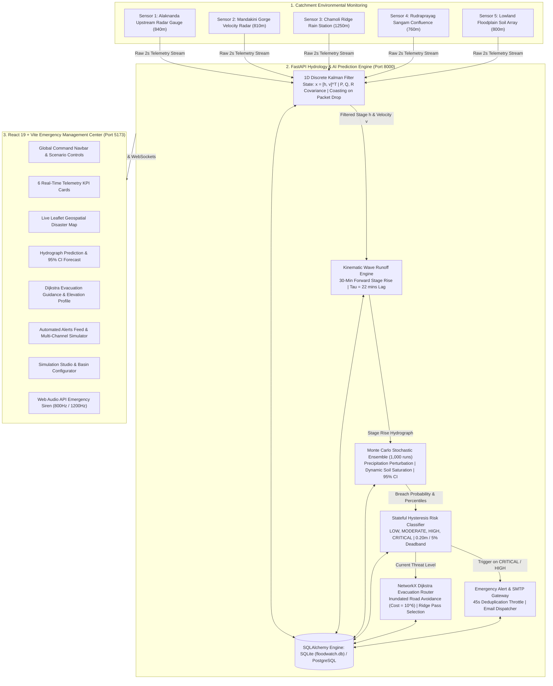

# FloodWatch AI – Intelligent Flash Flood Prediction & Early Warning System for Hilly Regions

[](https://sih.gov.in)
[](https://fastapi.tiangolo.com)
[](https://react.dev)
[](https://vitejs.dev)
[](https://tailwindcss.com)
[](https://leafletjs.com)
[](https://networkx.org)
[](https://pytest.org)

**FloodWatch AI** is a real-time, AI-driven disaster management and flash flood early warning platform engineered specifically for mountainous and hilly river basins (calibrated for the Alaknanda and Mandakini River catchments in Uttarakhand). 

The platform integrates:
1. **Multi-station environmental sensor telemetry** (rainfall intensity, raw river stage, and soil moisture).
2. **1D Discrete Kalman Filter state-space sensor fusion** suppressing white-water turbulence and acoustic bounce.
3. **Kinematic wave rainfall-runoff prediction engine** computing 30-minute forward stage trajectories with basin concentration lag ($\tau \approx 22\text{ mins}$).
4. **1,000-scenario Monte Carlo stochastic simulation** generating empirical breach probabilities against the 3.50m critical danger threshold and 95% confidence intervals.
5. **Stateful hysteresis risk classification** (`LOW`, `MODERATE`, `HIGH`, `CRITICAL`) with anti-chatter deadband buffers ($0.20\text{m} / 5\%$).
6. **NetworkX Dijkstra evacuation routing** that dynamically penalizes and blocks flooded gorge roads, safely directing evacuees uphill via mountain passes to designated high-ground shelters.
7. **Automated multi-channel emergency alert distribution** (Web Audio API siren synthesizer, in-app notification drawer, WebSockets, and SMTP email dispatcher).

---

## 🏗️ System Architecture



---

## 📁 Repository Structure

```
floodwatch-ai/
├── src/                                # Frontend React 19 Application
│   ├── components/
│   │   ├── Navbar.jsx                  # Brand logo, route links, scenario buttons & siren mute
│   │   ├── KpiCards.jsx                # 6 key metrics (Rainfall, Water Level, Soil, Probability, Risk, Lead Time)
│   │   ├── FloodMap.jsx                # Embedded Leaflet disaster map
│   │   ├── PredictionChart.jsx         # 30-min composed hydrograph with 95% confidence bounds
│   │   ├── RiskPanel.jsx               # Risk level diagnostics & action protocols
│   │   ├── SensorGraphs.jsx            # Live multi-sensor trend lines & raw vs filtered comparison
│   │   ├── EvacuationPanel.jsx         # Turn-by-turn evacuation summary & transit time
│   │   ├── AlertBanner.jsx             # Top flashing warning ribbon
│   │   ├── AlertHistory.jsx            # Emergency alert activity log
│   │   └── EmergencyAlertModal.jsx     # Auto-popup modal on HIGH/CRITICAL flood risk
│   ├── pages/
│   │   ├── LandingPage.jsx             # Public landing page with hero, telemetry preview, pipeline & helplines
│   │   ├── DashboardPage.jsx           # Integrated emergency command center
│   │   ├── LiveMapPage.jsx             # Fullscreen disaster map with layers, nodes drawer & convoy simulator
│   │   ├── PredictionPage.jsx          # AI prediction intelligence, hydrograph, multi-sensor charts & math
│   │   ├── EvacuationPage.jsx          # Dijkstra route, elevation profile, shelters directory & offline print card
│   │   ├── AlertsPage.jsx              # Automated alert feed, broadcast simulator & siren player
│   │   ├── SettingsPage.jsx            # Simulation Studio, polling frequency, basin select & IoT diagnostics
│   │   └── LoginPage.jsx               # Operator & Commander authentication
│   ├── context/
│   │   └── SensorContext.jsx           # Global state, 2s polling synchronization, alerts & scenarios
│   ├── services/
│   │   ├── api.js                      # Axios client with fallback models
│   │   └── audioService.js             # Web Audio API emergency siren synthesizer
│   ├── utils/
│   │   └── formatters.js               # Formatting utilities for telemetry & badges
│   ├── App.jsx                         # React Router v6 route configuration
│   ├── main.tsx                        # React application bootstrap
│   └── index.css                       # Tailwind CSS 4 styles
│
├── backend/                            # Backend Python FastAPI Engine
│   ├── app/
│   │   ├── main.py                     # FastAPI application entrypoint, CORS & WebSocket endpoints
│   │   ├── config.py                   # Pydantic v2 application configuration & thresholds
│   │   ├── database.py                 # SQLAlchemy engine, session maker & declarative Base
│   │   ├── models/__init__.py          # SQLAlchemy ORM models (Sensor, Reading, Prediction, Risk, Shelter, etc.)
│   │   ├── schemas/__init__.py         # Pydantic validation schemas for requests & responses
│   │   ├── services/
│   │   │   ├── kalman_filter.py        # 1D Discrete Kalman Filter state-space sensor fusion
│   │   │   ├── flood_prediction.py     # Kinematic wave 30-min runoff prediction engine
│   │   │   ├── monte_carlo.py          # 1,000-scenario Monte Carlo stochastic simulator
│   │   │   ├── risk_classifier.py      # Stateful hysteresis risk classification engine
│   │   │   ├── evacuation_router.py    # NetworkX Dijkstra topological road graph router
│   │   │   ├── alert_service.py        # Automated emergency alert generator & SMTP dispatcher
│   │   │   └── sensor_simulator.py     # Multi-station physics simulator (normal, warning, extreme)
│   │   ├── websocket/
│   │   │   └── manager.py              # WebSocket connection manager & topic publisher
│   │   └── routes/
│   │       ├── sensors.py              # Sensor telemetry, history & simulation endpoints
│   │       ├── predictions.py          # 30-minute flood forecasting & ad-hoc runs
│   │       ├── risk.py                 # Real-time risk assessments & hysteresis status
│   │       ├── evacuation.py           # Dijkstra evacuation route & shelter directory
│   │       ├── alerts.py               # Emergency alert feed & operator acknowledgment
│   │       ├── analytics.py            # Aggregate telemetry analytics & statistics
│   │       ├── map.py                  # Map GIS features (sensors, risk polygons, shelters)
│   │       ├── simulation.py           # Scenario switcher (normal, warning, extreme) & reset
│   │       └── auth.py                 # Operator JWT login & identity profile
│   ├── tests/
│   │   ├── test_kalman.py              # Kalman filter noise reduction & missing packet tests
│   │   ├── test_prediction.py          # Kinematic wave prediction & lag time tests
│   │   ├── test_monte_carlo.py         # Monte Carlo breach probability & confidence envelope tests
│   │   ├── test_evacuation.py          # Dijkstra evacuation router & flood road detour tests
│   │   └── test_routes.py              # Full REST API endpoint integration tests
│   ├── requirements.txt                # Python backend dependencies
│   ├── .env.example                    # Backend environment configuration template
│   └── pytest.ini                      # Pytest package root discovery configuration
│
├── package.json                        # Frontend dependencies & scripts
├── vite.config.js                      # Vite bundler configuration
└── README.md                           # Main project documentation
```

---

## ⚡ Quick Start & Execution

### 1. Prerequisites
- **Node.js**: v18.0.0 or higher
- **Python**: v3.11 or higher
- **Git**

### 2. Backend Setup
```bash
# Navigate to the backend directory
cd backend

# Create virtual environment (optional)
python -m venv venv
# Windows:
.\venv\Scripts\activate
# Linux/macOS:
source venv/bin/activate

# Install dependencies
pip install -r requirements.txt

# Run Pytest verification (18 tests verifying algorithms and routes)
python -m pytest tests/ -v

# Start the FastAPI server
python -m uvicorn app.main:app --host 127.0.0.1 --port 8000 --reload
```

- Backend API: `http://127.0.0.1:8000`
- Interactive Swagger UI: `http://127.0.0.1:8000/docs`
- ReDoc Documentation: `http://127.0.0.1:8000/redoc`

### 3. Frontend Setup
```bash
# In another terminal, navigate to the project root:
cd ..

# Install frontend dependencies
npm install

# Start Vite development server
npm run dev
```

- Frontend Application: `http://localhost:5173`

---

## 🧭 Application Pages

1. **Landing Page (`/`)**: Public interface explaining the 4-pillar disaster management pipeline, showing live telemetry preview, impact statistics, and official emergency helplines (NDRF `1078`, SDRF `1070`, National Emergency `112`).
2. **Main Dashboard (`/dashboard`)**: Unified control room featuring 6 real-time KPI cards, 30-minute hydrograph forecast with 95% confidence band, risk diagnostics, sensor graphs, Dijkstra evacuation panel, disaster map, and alert feed.
3. **Live Flood Monitoring Map (`/map`)**: Full-screen interactive Leaflet map with CartoDB Voyager tiles, 5 sensor stations, 3 river stream lines, 4 risk zone polygons, 4 high-ground shelters, browser geolocation, layer toggle checkboxes, slide-out node inspection drawer, and animated evacuation convoy simulator.
4. **AI Prediction Intelligence (`/prediction` or `/analytics`)**: Detailed hydrograph with shaded 95% Monte Carlo uncertainty band, 3 multi-sensor trend charts, and mathematical documentation of the Kalman filter, Kinematic wave runoff, and Monte Carlo engines.
5. **Dijkstra Evacuation Routing (`/evacuation`)**: Dynamic pathfinding summary (distance, transit time, elevation gain), topographic elevation profile chart, turn-by-turn guidance steps with hazard indicators, safe shelters inventory table, emergency contacts directory, and printable offline action card.
6. **Automated Emergency Alerts (`/alerts`)**: Live emergency alerts feed with severity filtering, operator acknowledgment, multi-channel broadcast simulator (Cell Broadcast/SMS, WhatsApp emergency bot, CAP v1.2 XML protocol, Police VHF radio), and manual siren test player.
7. **Settings & Simulation Studio (`/settings`)**: Interactive simulation control studio (Normal, Monsoon Downpour, Extreme Cloudburst), polling frequency selector (1s, 2s, 5s), basin selector, IoT gauge hardware diagnostics (battery %, solar power, LoRaWAN RSSI), and threshold customization form.
8. **Operator Login (`/login`)**: Operator and Commander authentication portal with one-click quick-fill credentials.

---

## 🔬 Core Algorithms & Formulations

### 1. 1D Discrete Kalman Filter State-Space Sensor Fusion
- **State Vector**: $\mathbf{x}_k = [h_k, v_k]^T$, tracking water stage height ($m$) and velocity rate of rise ($m/min$).
- **State Transition**: $\mathbf{F} = \begin{bmatrix} 1 & \Delta t \\ 0 & 1 \end{bmatrix}$ with $\Delta t = \frac{2}{60}\text{ min}$.
- **Innovation**: $\mathbf{y}_k = z_k - \mathbf{H} \mathbf{x}_{k|k-1}$ with $\mathbf{H} = [1, 0]$.
- **Measurement Noise Covariance**: $R = 0.04\text{ m}^2$.
- **Packet Drop Coasting**: Kinematically extrapolates state when telemetry packets drop without crashing the prediction loop.

### 2. Kinematic Wave Rainfall-Runoff Model
- **Non-linear Soil Runoff Coefficient ($C$)**:
  $$C(S_{moist}) = C_{base} + \frac{C_{sat} - C_{base}}{1 + \exp\left(-12 \cdot (S_{moist}/100 - 0.70)\right)}$$
- **Basin Concentration Lag**: $\tau_{lag} \approx 22\text{ minutes}$.
- **Stage Discharge Routing**: Outflow rate follows hydraulic power law $Q_{out}(h) = \kappa \cdot h^{1.5}$.

### 3. 1,000-Scenario Monte Carlo Stochastic Risk Simulation
- Stochastic perturbations on rainfall intensity $\mathcal{N}(1.0, 0.22^2)$, soil moisture $\mathcal{N}(0, 4.0^2)$, and channel roughness $\mathcal{N}(1.0, 0.10^2)$.
- **Empirical Breach Probability**:
  $$P_{flood} = \frac{\sum_{i=1}^{1000} \mathbb{I}\left(\max_{t \in [1, 30]} h_i(t) \ge 3.50\text{ m}\right)}{1000} \times 100\%$$
- Computes minute-by-minute percentiles ($p_{10}$ to $p_{95}$) and 95% Confidence Interval.

### 4. Stateful Hysteresis Risk Classification
- Four tiers: `LOW` ($0-20\%$), `MODERATE` ($20-40\%$), `HIGH` ($40-70\%$), `CRITICAL` ($70-100\%$).
- **Instant Escalation**: Any metric crossing the upper threshold immediately triggers higher alarm levels.
- **Buffered De-escalation**: Requires water level to fall by $\ge 0.20\text{m}$ and probability by $\ge 5.0\%$ across consecutive cycles to eliminate rapid alarm oscillation.

### 5. NetworkX Dijkstra Evacuation Routing with Inundation Avoidance
- Valley road network modeled as a topological weighted graph $G = (V, E)$.
- When river stage crosses critical danger thresholds ($h \ge 3.50\text{m}$), river gorge causeway edges are penalized with infinite weight ($10^6$) and marked impassable.
- Dijkstra algorithm computes the shortest safe uphill escape path to **Pine Ridge High Ground Shelter (Elevation: 1,420 m)** via the **Sector 4 Ridge Pass**.

---

## 🔐 Operator Credentials

| Role | Username | Password | Access Level |
|---|---|---|---|
| **Field Operator** | `operator` | `Flood@2026` | Live Telemetry & Alert Acknowledgment |
| **Disaster Commander** | `admin` | `Admin@123` | Full Incident Command Center Access |
| **SIH 2026 Grand Jury** | `sih_judge` | `Judge@2026` | Evaluator Mode |

---

## 📢 Simulation Data Transparency
All simulated sensor telemetry generated by the system includes explicit metadata:
- `"is_simulated": true`
- `"data_source": "SIMULATED"`

No synthetic data is represented as genuine physical gauge readings.# newfloodproject

# floodproject1

# floodproject1

# floodproject1

# floodproject1

